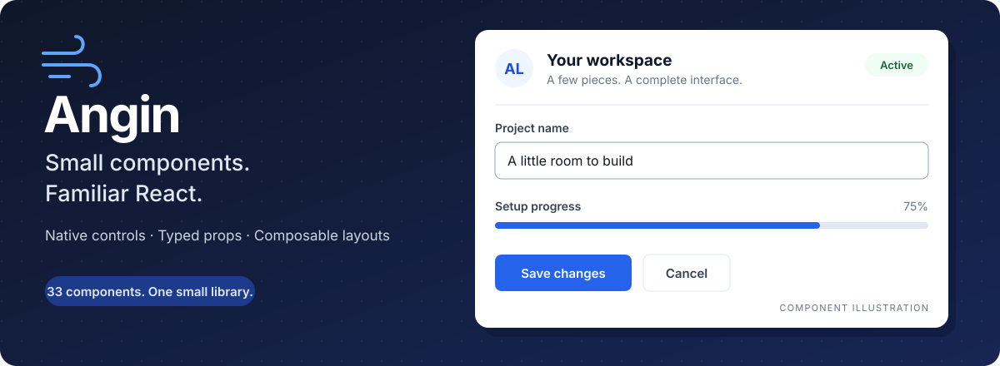

# Angin



A small React UI library with **46 components**, native form props, and composable
layouts. Bring your application's React installation; Angin has no additional
runtime dependencies.

[Quick start](#quick-start) · [Components](#components) · [Documentation](#documentation) · [Contributing](CONTRIBUTING.md)

## Install

```sh
npm install angin react react-dom
```

Keep `react` and `react-dom` on matching versions. Development and tests use
React 17; the peer dependency ranges also accept React 18 and 19.

## Quick start

Import the stylesheet once at your application's entry point. Use `angin-root`
for the library's typography, box sizing, and native control font inheritance.

<!-- typecheck-example -->
```tsx
import React, { useState } from 'react';
import { Button, Card, Input, Stack, Text } from 'angin';
import 'angin/styles.css';

export function Greeting() {
    const [name, setName] = useState('');
    const [greeting, setGreeting] = useState('');

    return (
        <main className="angin-root">
            <Card header="Hello, Angin">
                <form onSubmit={(event) => {
                    event.preventDefault();
                    setGreeting(`Hello, ${name.trim()}!`);
                }}>
                    <Stack gap="md">
                        <Input
                            id="greeting-name"
                            label="Your name"
                            value={name}
                            onChange={(event) => setName(event.currentTarget.value)}
                            required
                        />
                        <Button type="submit" disabled={!name.trim()}>Say hello</Button>
                        <Text role="status">{greeting}</Text>
                    </Stack>
                </form>
            </Card>
        </main>
    );
}
```

**Two useful defaults:** buttons use `type="button"`, so set `type="submit"`
inside a form. Fields accept native React change events; read
`event.currentTarget.value` or `event.currentTarget.checked` as usual.

For server rendering, give fields and composite widgets stable, unique IDs.
See the [SSR guide](docs/ssr.md) for the complete list and calendar date handling.

## Components

| Build with | Components | Guide |
| --- | --- | --- |
| Actions and forms | Button, IconButton, Input, Textarea, Select, Checkbox, Radio, Switch, Tooltip | [Controls](docs/controls.md) |
| Content and layout | Text, Heading, Link, Card, Stack, Divider | [Display and layout](docs/display.md) |
| Status and identity | Alert, Badge, Avatar, Progress, Skeleton, Spinner | [Display and layout](docs/display.md) |
| Selection and navigation | Tabs, TabbedNavigation, Accordion, Calendar, Menu, Breadcrumbs, Pagination, Stepper | [Composite components](docs/derived.md) |
| Data visualization | LineChart, AreaChart, BarChart, ScatterChart, BubbleChart, PieChart, DonutChart, RadarChart, RadialBarChart, HeatmapChart, GraphChart, CandlestickChart, Sparkline | [Charts](docs/charts.md) |
| Overlays and feedback | Modal, Drawer, Toast, EmptyState | [Composite components](docs/derived.md) |

All components are available from `angin`. Use per-component imports when you
prefer explicit entry points:

```tsx
import { Button } from 'angin/base/Button';
import { Calendar } from 'angin/derived/Calendar';
import { CandlestickChart } from 'angin/charts/CandlestickChart';
```

Both styles support production tree shaking. [Import details](docs/imports.md)
cover CommonJS, ES modules, and TypeScript resolution.

Charts include container-aware SVG layout, keyboard and pointer inspection, optional
data tables, and rendering budgets for dense series. Financial candles support
OHLC aggregation, volume, and time-range controls. Start with the [chart guide](docs/charts.md).

## Documentation

The documentation site includes searchable references for all 46 components,
interactive examples, generated prop tables, a chart gallery, and a playground.
Run `npm run build:docs` then `npm run docs` to open it locally at
`http://127.0.0.1:4173`. See [maintaining the site](docs/documentation-site.md)
for content authoring, checks, and static deployment.

| I want to… | Read |
| --- | --- |
| Set up my first screen | [Getting started](docs/getting-started.md) |
| Understand values, callbacks, and refs | [Props and callbacks](docs/props.md) |
| Add charts, financial candles, or a network graph | [Charts](docs/charts.md) |
| Change colors, spacing, and typography | [Styling](docs/styling.md) |
| Build a form with async submission | [Form example](docs/form-example.md) |
| Compose a paginated task list | [Dashboard example](docs/dashboard-example.md) |
| Check keyboard behavior and labeling | [Accessibility](docs/accessibility.md) |
| Render on the server | [SSR](docs/ssr.md) |
| Measure bundle and package size | [Performance](docs/performance.md) |
| Upgrade an existing integration | [Migration notes](docs/migration.md) |
| Run checks or contribute | [Testing](docs/testing.md) · [Contributing](CONTRIBUTING.md) |

## Development

```sh
npm ci --legacy-peer-deps
npm run check
```

The check includes TypeScript, chart stories, unit tests, both package builds,
consumer examples, server rendering, chart rendering budgets, and bundle budgets. For the component explorer:

```sh
npm run storybook
```

## License

See [LICENSE](LICENSE) for the licensing terms.
