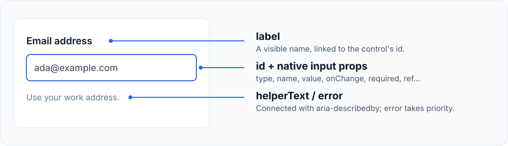

# Controls

[← Documentation](../README.md#documentation)

Use native React props for values, validation, and events. Controls forward refs
to their native DOM element; `Select` keeps a hidden form adapter whose `focus()` forwards to its custom trigger. `Tooltip` forwards its ref to a wrapper span.

## Buttons

`Button` defaults to `type="button"`. Set `type="submit"` when it should submit a
form. `loading` disables interaction and sets `aria-busy`; an explicit
`aria-busy` is preserved when loading is false.

<!-- typecheck-example -->
```tsx
import React from 'react';
import { Button, IconButton, Stack } from 'angin';

export function Actions({ onSave, saving }: { onSave: () => void; saving: boolean }) {
    return (
        <Stack direction="row" gap="sm">
            <Button loading={saving} onClick={onSave}>Save changes</Button>
            <IconButton
                icon={<span aria-hidden="true">✓</span>}
                label="Save changes"
                loading={saving}
                onClick={onSave}
            />
        </Stack>
    );
}
```

| Prop | Meaning |
| --- | --- |
| `size` | `"sm"`, `"md"` (default), or `"lg"` |
| `variant` | `"solid"`, `"outline"`, `"ghost"`, or `"danger"` |
| `loading` | Disable the button and show a spinner |
| `fullWidth` | Stretch `Button` to its container width |
| `label` | Required accessible name for `IconButton` |

`Button` defaults to the solid variant; `IconButton` defaults to ghost.

## Text fields and selects



`Input`, `Textarea`, and `Select` share `label`, `helperText`, `error`, and
`controlSize`. An error replaces helper text and marks the control invalid.
`Input` and `Textarea` apply `className`, `testId`, and `ref` to the native control. `Select` applies `className` and `style` to its visible trigger; `testId` and `ref` target its hidden native form adapter.

<!-- typecheck-example -->
```tsx
import React from 'react';
import { Input, Select, Stack, Textarea } from 'angin';

const topics = [
    { label: 'Support', value: 'support' },
    { label: 'Feedback', value: 'feedback' },
] as const;

export function ContactFields() {
    return (
        <Stack gap="md">
            <Input
                id="contact-email"
                name="email"
                label="Email address"
                type="email"
                autoComplete="email"
                helperText="Use your work address."
                required
            />
            <Select id="contact-topic" name="topic" label="Topic" options={topics} />
            <Textarea id="contact-notes" name="notes" label="Notes" rows={4} />
        </Stack>
    );
}
```

### Labels and descriptions

Fields generate a stable client-side ID when `id` is omitted. For server
rendering, supply explicit, unique IDs so server and client markup agree.
A field with `id="email"` uses `email-description` for its displayed message.
Existing `aria-describedby` IDs are combined with that message ID.

### Native props and option groups

`controlSize` changes visual sizing. Native numeric `size` remains available for
input width or an inline custom select list's approximate row count. Select accepts readonly `options` collections,
whose entries have `value`, `label`, and optional `disabled`.

Omit `options` to provide native children, including option groups:

```tsx
<Select id="region" label="Region" defaultValue="my">
    <optgroup label="Asia">
        <option value="my">Malaysia</option>
        <option value="jp">Japan</option>
    </optgroup>
</Select>
```

Select uses a custom popup, including for `multiple`. Up/Down, Home/End, and
label typeahead preview options; Enter/Space select them. Escape cancels the
preview and Tab dismisses without trapping focus. Disabled choices and groups
are skipped. In multiple mode, selecting an option toggles it and keeps the list
open. Use unique option values and native `option`/`optgroup` children or fragments.

Form values, `onChange`, `required`, external `form` association, and resets use
the native adapter. Controlled parents must apply the next value. Click, focus,
blur, and keydown callbacks also retain the native select as `currentTarget`.
The visible control exposes combobox semantics; target it by role in UI tests.
Programmatic value changes should dispatch a bubbling change event. Native
`showPicker()` is not the custom popup API.

For async submission and loading/error feedback, see the complete
[form example](form-example.md).

## Checkboxes, radios, and switches

All three preserve native `checked`, `defaultChecked`, and change events. Read
`event.currentTarget.checked` for the next value.

<!-- typecheck-example -->
```tsx
import React, { useState } from 'react';
import { Checkbox, Stack, Switch } from 'angin';

export function Preferences() {
    const [enabled, setEnabled] = useState(false);

    return (
        <Stack>
            <Checkbox id="terms" name="terms" label="I agree to the terms" required />
            <Switch
                id="notifications"
                label="Email notifications"
                description="Receive a summary each week."
                checked={enabled}
                onChange={(event) => setEnabled(event.currentTarget.checked)}
            />
        </Stack>
    );
}
```

- The required `label` is rendered inside a wrapping label.
- `description` appears below it; provide `id` to link it to the control.
- Checkbox's `error` replaces its description and sets `aria-invalid`.
- Give Radio controls the same native `name` to form a group.
- `className` styles the outer field; `testId` and `ref` identify the input.

## Tooltips

Tooltip shows `content` on focus or hover and dismisses it with Escape. Use
`defaultOpen` for initial visibility, or `open` with `onOpenChange` for controlled
visibility. The caller must apply requested changes in controlled mode.

<!-- typecheck-example -->
```tsx
import React from 'react';
import { Tooltip } from 'angin';

export function SaveHelp({ onSave }: { onSave: () => void }) {
    return (
        <Tooltip id="save-help" content="Save your current changes">
            <button type="button" onClick={onSave}>Save</button>
        </Tooltip>
    );
}
```

Use a **single native, focusable element** as the trigger. Tooltip merges its
description onto that element without replacing its ref, event handlers, or
existing description IDs. The trigger still needs its own accessible name.

Fragments, multiple children, and composite components retain the wrapper
relationship as a fallback. ARIA descriptions do not inherit into descendants;
those triggers need their own integration. Tooltip content should be informational,
without interactive controls.

An explicit `id` produces `${id}-tooltip`; `testId` produces `${testId}-content`.
Otherwise Tooltip generates a client-side ID. Supply a unique explicit ID for SSR.
